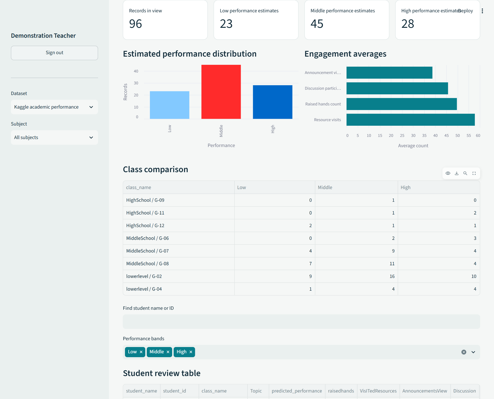
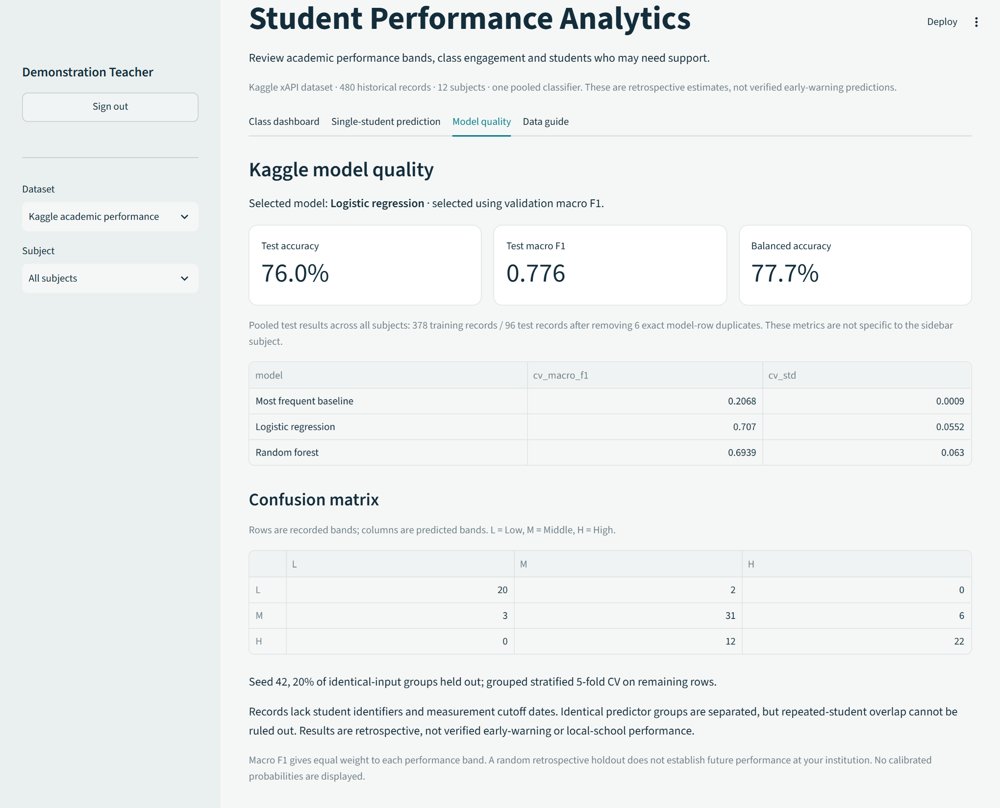

# StudentInsight student performance analytics

StudentInsight is a staff workspace for teachers, lecturers, principals, headmasters and heads of department. It provides class charts, student review tables, name-or-ID uploads, individual predictions and CSV reports.

The default workspace now uses **Kaggle xAPI-Edu-Data version 6** to estimate **Low, Middle or High academic performance**. These are source-defined outcome bands, not exact marks or probabilities of passing. The earlier Mathematics and Portuguese grade models remain under **Dataset > UCI grade reference**.

## Run the staff application

From the project directory on Windows:

```powershell
python -m venv .venv
.\.venv\Scripts\python.exe -m pip install -r requirements.txt
.\.venv\Scripts\python.exe -m streamlit run app.py --server.port 8502
```

Open http://127.0.0.1:8502. Alternatively, `./run.ps1 -Full` installs dependencies and launches the staff app. Select `.venv\Scripts\python.exe` in the IDE to avoid missing-package errors such as missing `sklearn`.

Use **Sign up** for a new staff account or **Sign in** for an existing account. Additional registrations remain available. Accounts belong to the installation and do not automatically synchronize between local and hosted copies. Passwords use salted PBKDF2-HMAC-SHA256; session tokens are hashed, expire and are revoked on sign-out. Login and registration throttling are enforced. Institutional roles, email recovery and permanent student histories are not implemented.

The Kaggle CSV is bundled. Normal startup needs no Kaggle account or network download. The app trains and caches a public classifier in memory. Private uploads never retrain it.

## Kaggle data and subjects

Source: [Students' Academic Performance Dataset](https://www.kaggle.com/datasets/aljarah/xAPI-Edu-Data), by **Elaf Abu Amrieh, Thair Hamtini and Ibrahim Aljarah**, University of Jordan. The dataset card describes Kalboard 360 LMS records collected with xAPI tracking. Version 6 is licensed **CC BY-SA 4.0**. The original CSV is preserved in [data/kaggle](data/kaggle); [provenance.json](data/kaggle/provenance.json) records attribution, description, version and SHA-256 checksum.

The **480 records cover 12 topics**: Arabic, Biology, Chemistry, English, French, Geology, History, Information Technology, Mathematics, Quran, Science and Spanish. Topic counts range from 19 History records to 95 IT records. One pooled classifier includes Topic as an input; these are not twelve independently validated models. The source has no Portuguese, Physics or Geography records.

Target `Class`: **L = Low (0-69), M = Middle (70-89), H = High (90-100)**. Exact marks are absent. These are source definitions, not university pass rules.

| Nine model inputs | Accepted values |
| --- | --- |
| `raisedhands`, `VisITedResources`, `AnnouncementsView`, `Discussion` | Observed whole-number counts 0-100 |
| `StageID`, `GradeID` | Source categories and observed combinations listed in Data guide |
| `Topic` | One of the twelve source topics |
| `Semester` | `F` or `S` |
| `StudentAbsenceDays` | `Under-7` or `Above-7` |

Names, IDs, outcomes, demographics, section and parent attributes are excluded from predictors. No missing input is filled automatically. The source records G-07 in more than one stage; original categories are retained. Exactly seven absence days is undefined in the source; do not guess a band.

Restore the pinned CSV with `.\.venv\Scripts\python.exe download_kaggle.py`. The downloader checks archive and member sizes, reads only the expected CSV and rejects checksum mismatches before changing data. Keep the bundled CSV for offline startup. Other [research datasets](documents/dataset-catalog.md) are separate from integrated training data.

## Training and measured results

```powershell
.\.venv\Scripts\python.exe train.py
```

Six duplicate rows in the selected input-and-outcome representation are removed, leaving **474 model rows**, not verified unique students. Identical input vectors are grouped. A fixed seed-42 split holds out 20% of groups, yielding **378 development records and 96 test records**. Grouped stratified five-fold validation uses development data only; scaling and one-hot encoding are fitted within each fold.

| Candidate | Validation macro F1 | Fold SD |
| --- | ---: | ---: |
| Most-frequent baseline | 0.207 | 0.001 |
| Logistic regression | **0.707** | 0.055 |
| Random forest | 0.694 | 0.063 |

The highest validation macro F1 wins. Logistic regression uses C=1 and up to 2,000 iterations. The forest has 250 trees, maximum depth 10, minimum leaf size 3 and balanced class weights. The selected pipeline is refitted on development records before test evaluation.

| Test metric | Measured value |
| --- | ---: |
| Accuracy | 76.0% (73 of 96) |
| Macro F1 | 0.776 |
| Balanced accuracy | 77.7% |

[Metrics](artifacts/kaggle/metrics.json) and [test predictions](artifacts/kaggle/test_predictions.csv) preserve candidate scores, partitions, schema, fingerprints and dependency version. Quality metrics describe the pooled test set even when a sidebar subject is selected. No calibrated individual probabilities are displayed.

The dataset lacks student identifiers and verified measurement cutoff dates. Grouping prevents identical-input overlap, but cannot exclude every repeated-student overlap or establish that predictors precede the outcome. These are retrospective results, **not verified early-warning or local-institution performance**. More subjects does not automatically mean more reliable predictions. Independent local and temporal evaluation remains necessary.

## Class and individual workflows

Four tabs provide **Class dashboard**, **Single-student prediction**, **Model quality**, and **Data guide**.

- The historical example contains 96 holdout records. Source-row labels identify rows, not unique students. Example groups are education stage and grade level, not local classes.
- Download the Kaggle template for class uploads. Supply `student_name` or `student_id` (or both), `class_name`, and all nine inputs. Optional `Class` outcomes may be L, M, H or blank and never enter the model.
- Duplicate IDs and ambiguous names within a class are rejected. Students sharing a name need distinct IDs. Uploads are limited to 2 MiB and 5,000 rows, with strict headers, ranges and categories.
- Subject and group filters affect charts and tables; name and band filters affect the student table and its export. Exports retain dataset/model context and neutralize formula-like text.
- Predict one student without a CSV by entering optional identifying labels and required observed inputs, then choosing **Predict performance band**. Results describe the last submitted profile.

Uploads and results remain in the signed-in session and are cleared on sign-out. Download authorized reports explicitly. A Low estimate is a prompt for staff review, not an automatic decision.

## Google Colab Jupyter Notebook and Drive

[](https://colab.research.google.com/github/GamerStudioszw/Student-Performance-Prediction/blob/main/notebooks/StudentInsight.ipynb)

The [notebook](notebooks/StudentInsight.ipynb) trains the same Kaggle classifier, shows charts and a confusion matrix, predicts an individual example, optionally reads a class CSV and exports reports. A separately labelled UCI section retains grade experiments. CPU is sufficient.

**Colab:** open the link, connect a hosted Python runtime and run cells in order. Setup clones `main` when absent and installs requirements into that kernel. Existing checkouts are reused without pulling or overwriting edits; start a fresh runtime for current `main`. Record the printed Git revision. Restart and rerun if installation requests it. Hosted runtime files are temporary; save outputs. See the [official Colab FAQ](https://research.google.com/colaboratory/faq.html).

**Local Jupyter:** run `./run-notebook.ps1`, select **StudentInsight (.venv)** and execute cells in order. Use `./run-notebook.ps1 -Lab` for JupyterLab. The launcher installs `requirements-notebooks.txt` and registers the kernel. See [Jupyter installation documentation](https://jupyter.org/install).

**Drive:** `USE_GOOGLE_DRIVE = IN_COLAB` enables Google's mount authorization in hosted Colab. Set it to `False` to skip. Local Jupyter can use an existing synced folder through `LOCAL_DRIVE_FOLDER`; it does not mount a Google account itself.

| Drive location | Contents |
| --- | --- |
| `StudentInsight/datasets` | Explicit class CSV inputs; Kaggle and UCI schemas differ |
| `StudentInsight/reports` | Unique experiment ZIPs, checked by hash and never overwritten |
| `StudentInsight/projects` | Committed project ZIP, clean notebook and checksum manifest |

Section 1b saves a committed project snapshot when connected. Commit tracked changes first. Ignored accounts, credentials, environments, private uploads, binary models and untracked research downloads are excluded. The ZIP does not include Git history; recreate dependencies from requirements files.

Experiment exports include Kaggle metrics, test predictions and the individual example alongside UCI reference outputs. Environment provenance records the Git revision and whether tracked files had local changes when exported. Use `KAGGLE_CLASS_CSV` only for a Kaggle-schema file. The optional UCI class cell uses a different schema. `SAVE_REPORTS_TO_DRIVE` controls copying report ZIPs after connection.

A notebook saved in Drive is an independent copy. Reopen the GitHub Colab link for notebook updates and use a fresh runtime for updated project code. For local Jupyter, save your work, close the notebook, run `git pull --ff-only`, then reopen it and restart the kernel. The notebook's final section explains updates and supervisor sharing.

Saving files **does not grant access**. Share the intended Drive folder or notebook with **czano@buse.ac.zw** as Viewer and verify the permission list. Google-hosted execution, remote synchronization and his access have not been verified from this session.

## Git and GitHub

Repository: [GamerStudioszw/Student-Performance-Prediction](https://github.com/GamerStudioszw/Student-Performance-Prediction).

```powershell
git clone https://github.com/GamerStudioszw/Student-Performance-Prediction.git
cd Student-Performance-Prediction
git pull --ff-only
git status
git rev-parse HEAD
```

Before sharing changes, run tests, inspect `git diff` and stage intended files only. For example, after an authorized README edit:

```powershell
git add README.md
git commit -m "Update project documentation"
git push origin main
```

Git records local revisions; GitHub hosts the remote. A commit alone does not upload changes. Do not force-push over teammates' work or commit secrets, account databases or private class files. See the [Git clone reference](https://git-scm.com/docs/git-clone) and [GitHub push documentation](https://docs.github.com/en/get-started/using-git/pushing-commits-to-a-remote-repository).

## Verification

```powershell
.\.venv\Scripts\python.exe -m unittest discover -s tests -v
```

**92 tests passed on 28 October 2026.** The updated notebook executed locally with Drive disabled, including Kaggle training and exports. A real local browser check covered registration, sign-in, Kaggle charts, review tables, individual prediction and model-quality display. Screenshots use a temporary demonstration account and historical or explicitly illustrative records. Hosted-site verification and Google authorization remain separate checks.

## Academic documentation

**Bindura University of Science Education**; **Network Engineering**; module **Artificial Intelligence and Intelligent System**; supervisor **Mr C. Zano**.

The [Word report](documents/milestones/StudentInsight_Five_Chapter_Report.docx) and [PDF report](documents/milestones/StudentInsight_Five_Chapter_Report.pdf) follow five milestone chapters: Proposal (Week 4), Design (Week 7), Prototype (Week 10), Integration (Week 13), and Final (Week 15). They include real screenshots, code images, Kaggle results, Git/GitHub, Colab, Jupyter, Drive and the supplied rubric. The [15-minute demo guide](documents/milestones/StudentInsight_Demo_Guide.docx) covers the current workflow.

The report is **20 pages including its cover and references**; all rendered pages were visually checked. Application evidence baseline: `5af3632`. Complete group number, names, student numbers and role allocations before submission. The [existing presentation](documents/milestones/StudentInsight_Milestone_Presentation.pptx) is the **earlier UCI edition** and needs revision before presenting Kaggle results. The original proposal remains historical documentation.

Editable report content and evidence are in [source](documents/milestones/source). Builders are `scripts/build_documentation.py` and `scripts/render_code_figures.py`. [Figures](documents/milestones/figures) include actual account screens, charts, review tables, an individual report, model quality and source excerpts. Render and visually check rebuilt documents before submission.





## UCI reference and lightweight demo

Select **UCI grade reference** for the earlier Mathematics and Portuguese G3 estimates. Their original UCI files, 0-20 scale, after-period-two timing, G2 persistence predictor and intervals remain separate from Kaggle classification. Train them explicitly:

```powershell
.\.venv\Scripts\python.exe train.py --dataset uci
```

`--dataset all` trains both. `download_data.py` restores UCI files; it does not download Kaggle. UCI source: [Student Performance](https://archive.ics.uci.edu/dataset/320/student+performance), Paulo Cortez, 2008, DOI 10.24432/C5TG7T, CC BY 4.0. Historical evidence remains in `artifacts/v3/` and `artifacts/audits/`.

The dependency-free Mathematics demo still runs with `python lightweight_app.py` or `./run.ps1` without `-Full`. It is separate from the Kaggle staff app, with its own model and historical metrics.
